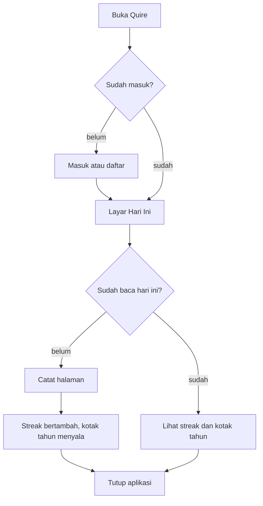
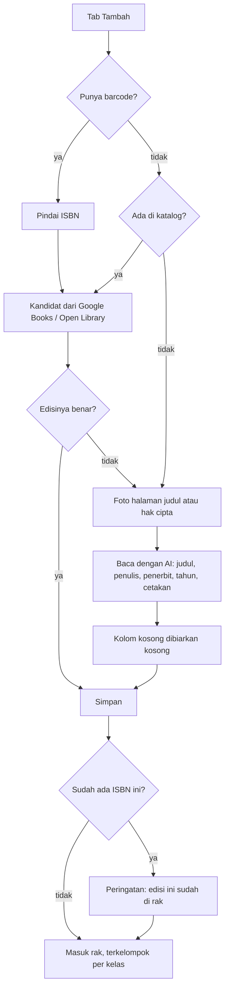
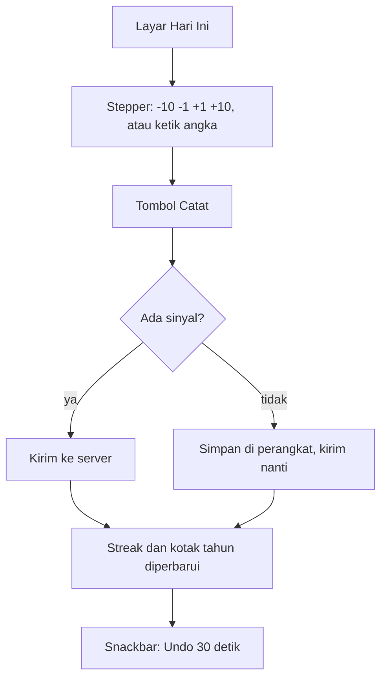
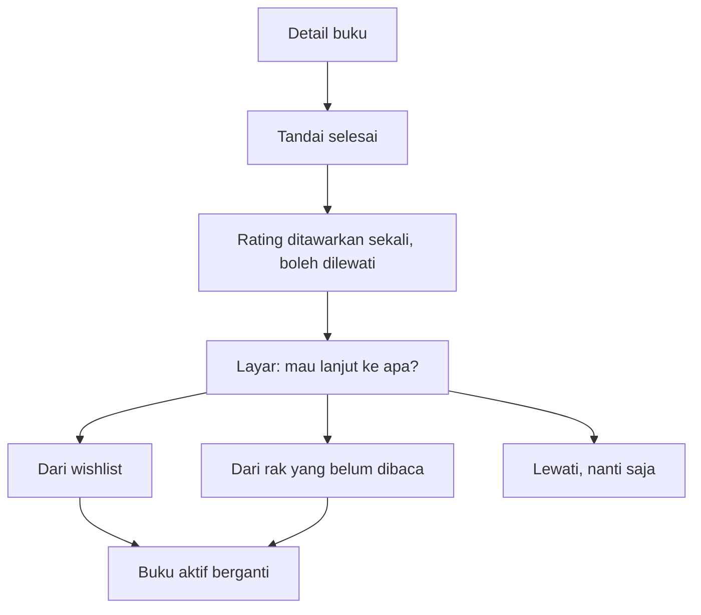

# Quire — App Flow

Peta perjalanan. Semua yang di bawah ini ditulis sebagai niat pengguna, bukan nama layar.

## Alur Utama Harian

Aturan: membuka aplikasi **tidak** dihitung sebagai hari membaca. Hanya halaman yang dicatat.

## Menambah Buku

**Mode sapu:** setelah satu buku tersimpan, kamera langsung siap memindai berikutnya. Jumlah buku hari ini tampil kecil di atas. Tidak ada layar perayaan.

## Mencatat Halaman

## Menutup Buku dan Memilih Berikutnya

Kalau pengguna melewati, layar Hari Ini menampilkan satu kalimat dan tombol memilih — bukan rak kosong yang bisu.

## Mencari Buku

1. Ketik apa saja — judul, penulis, nama kelas, atau bahasa.
2. Bagian atas: hasil dari rak sendiri.
3. Bagian bawah: kandidat dari katalog, dengan tombol **Tambah ke rak**.
4. Kosong: satu kalimat, lalu tombol ke tab Tambah.

## Wishlist

- Ditambahkan dari pencarian katalog atau manual.
- Tidak pernah muncul sebagai buku aktif.
- Tidak dipakai untuk menghitung target tahunan.

## Kotak Tahun

- Dibuka dari layar Hari Ini.
- Menampilkan 12 bulan kotak, warna dari jumlah halaman.
- Angka pendamping: buku selesai, halaman, dan bahasa.
- Bisa disaring per bahasa.
- Tidak ada lencana, tidak ada perayaan palsu.

## Keadaan Tidak Nyaman yang Harus Ditangani

| Kejadian | Perilaku |
|---|---|
| Buku tanpa jumlah halaman | Progres tampil "halaman 40", tanpa batang persen |
| Katalog tidak menemukan apa pun | Tawarkan foto halaman judul, lalu ketik manual |
| AI salah membaca | Semua kolom bisa disunting sebelum simpan |
| ISBN sudah ada | Peringatan, tanpa menggabung otomatis |
| Tanpa sinyal | Semua aksi tersimpan lokal, indikator kecil "belum terkirim" |
| Sesi kedaluwarsa | Diarahkan masuk kembali; aksi yang sedang diketik tetap tersimpan |
| Streak hampir putus | Satu tombol pemulihan, sekali per bulan, tanpa iklan |
| Buku selesai tapi belum ada berikutnya | Tawaran memilih, boleh dilewati |
| Proyek Supabase tidur | Tampil lambat sekali, lalu normal; tanpa layar error menakutkan |

## Yang Tidak Ada di Alur Ini

Onboarding berlapis, tur aplikasi, notifikasi push, mengikuti teman, berbagi ke media sosial, lencana, dan layar perayaan.
