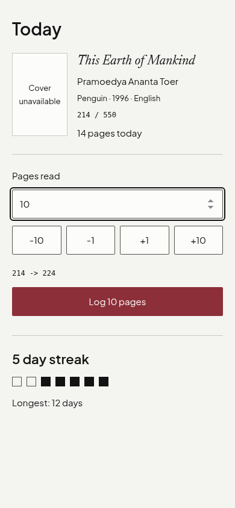
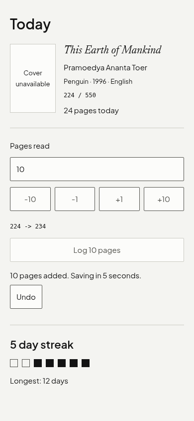

# Reading loop evidence

Verified 29 October 2026 on `feat/reading-loop`.

## Screenshots

390 × 844, shelf light. The standalone fixture uses explicit sample book/streak data and an injected fake RPC, with no writes to a reader's library. The missing-cover fallback is intentional.





Images and the reproducible preview live inside the owned reading feature directory.

## Integration

Import `TodayScreen` and `usePageLog` from `src/features/reading`. Pass the authenticated Supabase client as `client`, the book's confirmed progress, today's pages, book ID, and the reader's local calendar `day` (`YYYY-MM-DD`) to the hook. Pass its return value as `pageLog`. Supply `book`, `streak` (seven oldest-to-newest days ending today), and `onCatalogue` to the screen. `editionLine` belongs to the caller so edition metadata is never inferred. Null totals omit the denominator.

Mount the hook once per reader/book/day, using a React key for that identity. Inputs are initial confirmed server values, not continuously controlled values. Styles import automatically with the screen and use the existing semantic tokens. Cover dimensions derive from existing metric tokens to keep the required 92 × 138 box without modifying shared tokens.

Logging immediately updates progress and pages today. Undo cancels the unsent log during a five-second window. After that window, `log_pages` receives `p_book`, `p_pages`, and the original `p_day`. A pending log blocks another log until it is confirmed or undone. The hook pauses its timer on unmount and resumes it on effect restart. Unsent entries persist in localStorage per unique book ID, restore on remount, and retry on reconnect or the Retry button. If storage is unavailable, the mounted queue still works. Confirmed server streak counts replace supplied counts.

The database exposes no compensating undo RPC and rejects negative pages, so undo ends when sending begins. Reloading restores an entry as queued, without a renewed undo window. The RPC has no idempotency key: a response lost after a server commit can cause a retry to double-count. This requires a future database contract change for exactly-once delivery. Run one mounted logger per book; cross-tab coordination is outside this feature. A full app reload while offline requires the app shell to be cached, which this feature does not implement.

## Verification

- Unit tests exercise four step increments, clamping, direct input normalization, exact preview strings, unknown totals, the empty state, optimistic undo with no RPC, timer pause/resume, persisted offline queues, failed and successful retries, and concurrent-send guards.
- Browser checks exercise the actual hook through the fixture: input, log, undo, simulated offline status, persisted queue after reload, and reconnect retry with the fake client.
- All six theme modes at 320, 390, 768, and 1280 pixels: no horizontal overflow, 92 × 138 cover, minimum 48-pixel control targets, and 2-pixel keyboard focus.
- The Impeccable mechanical detector returned `[]`. Existing theme contrast tokens are preserved; no colors or opacity reductions are introduced.
- Reproduce: start `npm run dev -- --host 127.0.0.1 --port 5195`, then run `node src/features/reading/evidence/capture.mjs` with system Brave available.
- Screenshots were visually reviewed. Route wiring is intentionally left to the later integration task.

## Gate output

`npm run gate` exited successfully. Database smoke and browser smoke both ran against local Supabase.

```text

> quire@0.1.0 gate
> bash scripts/gate.sh

== biome
Checked 61 files in 25ms. No fixes applied.
== typecheck
== tests

> quire@0.1.0 test
> vitest run src --passWithNoTests


 RUN  v5.0.5 /home/nojin/works/quire/.worktrees/feat-reading-loop


 Test Files  10 passed (10)
      Tests  80 passed (80)
   Start at  10:37:45
   Duration  324ms (import 44%, transform 30%, tests 18%, worker 8%)

== build
== database smoke (skipped when supabase is down)
ok   insert a book
ok   row level security hides another shelf
ok   duplicate ISBN refused
ok   only one active book allowed
ok   streak 2026-10-26
ok   streak 2026-10-26
ok   streak 2026-10-27
ok   streak 2026-10-29
ok   streak 2026-10-31
ok   streak 2026-11-02
ok   two logs on one day add up

all database checks passed
== docs present
== end to end smoke (skipped when supabase or system Chromium is unavailable)

> quire@0.1.0 test:e2e
> playwright test

[WebServer] (node:364080) Warning: The 'NO_COLOR' env is ignored due to the 'FORCE_COLOR' env being set.
[WebServer] (Use `node --trace-warnings ...` to show where the warning was created)

Running 4 tests using 1 worker

(node:364126) Warning: The 'NO_COLOR' env is ignored due to the 'FORCE_COLOR' env being set.
(Use `node --trace-warnings ...` to show where the warning was created)
  ✓  1 tests/e2e/auth.spec.ts:3:1 › sign up, open the catalogue, and sign out (862ms)
  ✓  2 tests/e2e/catalog.spec.ts:3:1 › search, save a candidate, and refuse a persisted duplicate (1.9s)
  ✓  3 tests/e2e/catalog.spec.ts:60:1 › empty query shows guidance and prevents provider searches (606ms)
  ✓  4 tests/e2e/settings.spec.ts:3:1 › theme chosen in settings is applied and survives a reload (794ms)

  4 passed (5.4s)
gate ok
```
