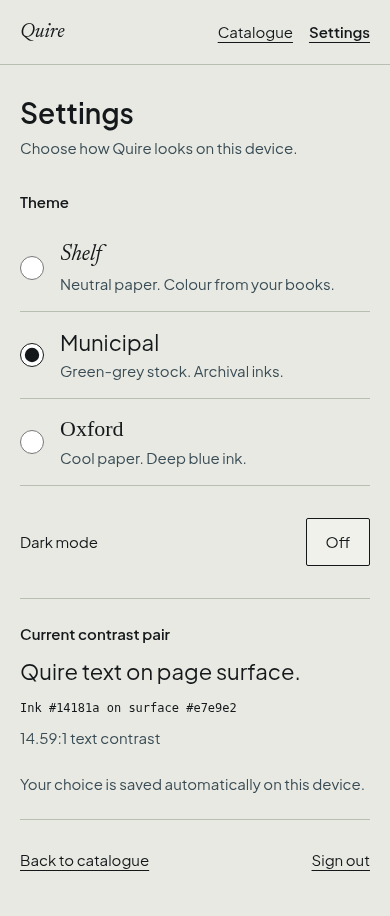

# Theme switcher (#19)

Branch: `feat/theme-switcher`, based on `refactor/quality`.

## Implementation

The authenticated header links to Settings and Catalogue using hash navigation, including browser Back. Native theme radios preserve the selected mode; the Dark mode switch preserves the theme. The HTML attribute and `quire-theme` storage value both use `<theme>-<mode>`.

`App.tsx` restores the saved palette synchronously during module startup before React mounts. Missing, invalid or unreadable preferences resolve to `shelf-light`. A failed write still applies the theme and shows an actionable storage message. Sign out uses the existing session flow and retains the device theme.

The contrast sample reads `--ink` and `--surface` from computed CSS and measures WCAG relative luminance. It does not duplicate palette values. Theme names use Newsreader italic (Shelf), Plus Jakarta Sans (Municipal), and Georgia (Oxford). The appended `--settings-oxford-font` token supplies Oxford's specimen family without changing the shared interface typography. Existing radius, spacing, colour and type tokens supply the screen styles.

## Browser checks

Chromium against Vite on port 5174 and real local Supabase. Created a disposable local account through the existing signup form. Checked every palette at widths 390, 768 and 1280, height 844. Each selection updated both HTML and localStorage, displayed the correct pair, and had no horizontal overflow. Theme choice labels, navigation links and buttons had at least 48px target height.

| Palette | Ink | Surface | Measured contrast |
| --- | --- | --- | --- |
| shelf-light | #131313 | #f4f4f1 | 16.86:1 |
| shelf-dark | #f2f2ee | #121212 | 16.69:1 |
| municipal-light | #14181a | #e7e9e2 | 14.59:1 |
| municipal-dark | #edf0e8 | #14181a | 15.51:1 |
| oxford-light | #101820 | #f6f7f5 | 16.65:1 |
| oxford-dark | #eef2f4 | #0f1418 | 16.45:1 |

- Reload restored `oxford-dark` and the selected controls. A subsequent reload with `municipal-light` recorded that saved theme at both the first-paint and first-contentful-paint observer callbacks.
- ArrowDown selected Municipal from Shelf. Space toggled the mode. The focused switch had a 2px solid outline.
- Back to catalogue opened Add a book. Browser Back returned to Settings.
- Intercepted only writes to `quire-theme` to simulate blocked storage: Oxford applied immediately and the storage failure message appeared. Restoring storage and selecting Municipal saved successfully.
- Sign out returned to Sign in and retained `municipal-light` in both HTML and storage.
- The mechanical UI detector reported no findings on the changed UI targets.

## Settings screenshot

Municipal light at 390px, full page. The screenshot lives inside the permitted settings directory to keep all added files within the task's path boundary.



## Unit tests and gate

Five new tests cover all six resolve/persist/restore round trips, invalid preferences, denied storage access/read/write, and WCAG contrast calculation. The existing 54 tests also pass. The database smoke ran against local Supabase and passed rather than skipping.

Final `npm run gate` output:

```text

> quire@0.1.0 gate
> bash scripts/gate.sh

== biome
Checked 49 files in 11ms. No fixes applied.
== typecheck
== tests

 RUN  v5.0.5 /home/nojin/works/quire/.worktrees/quality-boundary


 Test Files  9 passed (9)
      Tests  59 passed (59)
   Start at  10:15:52
   Duration  159ms (import 40%, transform 24%, tests 21%, worker 15%)

== build
== database smoke (skipped when supabase is down)
ok   insert a book
ok   row level security hides another shelf
ok   duplicate ISBN refused
ok   only one active book allowed
ok   streak 2026-10-26
ok   streak 2026-10-26
ok   streak 2026-10-27
ok   streak 2026-10-29
ok   streak 2026-10-31
ok   streak 2026-11-02
ok   two logs on one day add up

all database checks passed
== docs present
gate ok
```
