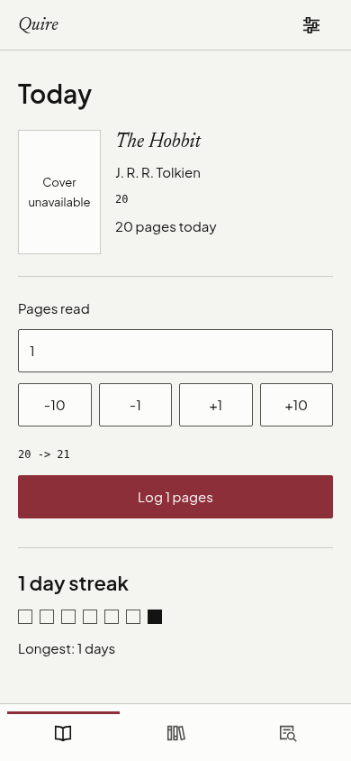

# Screen wiring evidence

Branch: `feat/wire-screens`.

Captured against the running local Supabase stack with system Brave at a mobile width of 390 pixels. Reduced motion was enabled for stable screenshots. The capture creates a temporary account and three persisted books, then removes the account and its rows in `finally`.

Today displays the seeded active book, The Hobbit, with 20 persisted pages for the capture day and the actual streak row. Unknown cover and edition metadata remain absent. Shelf displays three seeded books grouped by class. These screenshots use real local database reads, without mocked book, progress or streak responses.

## Validation

`npm run gate` passed: Biome, TypeScript, 127 unit tests across 15 files, production build, database smoke checks, required documents and all four existing Playwright tests. Full output: [gate-output.txt](gate-output.txt).

The injected-client integration hook tests cover no active book, one active book with persisted progress and streak, a missing streak row, and error recovery through retry.

Additional browser checks passed for empty Today, page logging with undo and save followed by reload, Shelf loading and retry, all four route reloads and active navigation links, no horizontal overflow at 390 pixels, ISBN scan fallback filling and automatically submitting the existing catalogue search, and an empty state after deleting the streak row. The retry check injects a denied response, then resumes real database reads. The scan check returns empty catalogue provider results; it does not create catalogue data. Full output: [browser-output.txt](browser-output.txt).

To reproduce the screenshots and browser checks, start `npm run dev -- --host ::1 --port 5175 --strictPort` using the local `.env`, then run `node docs/evidence/wiring/capture.mjs` from the repository root. The script reads local Supabase credentials without printing them.

## Review

Prepared PR description: [PR_BODY.md](PR_BODY.md). No PR was opened and nothing was pushed.
